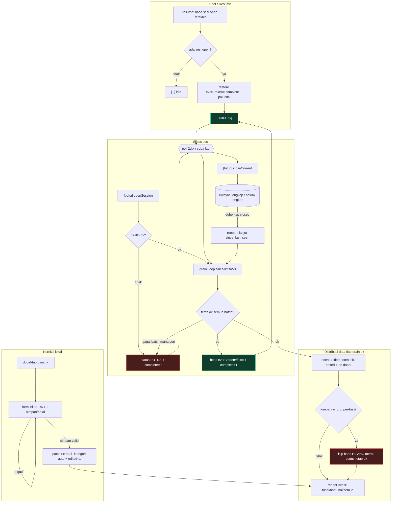
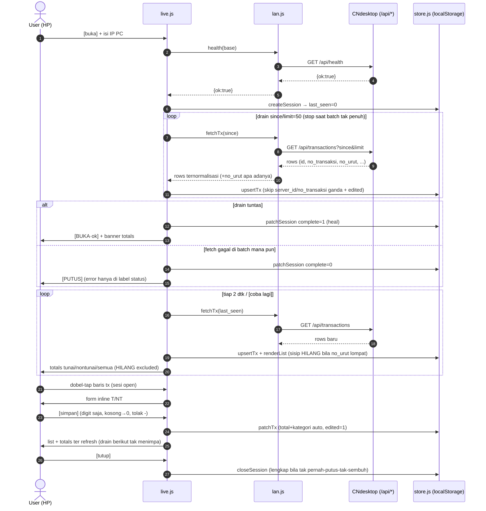

# Live flow: state machine + interaksi komponen

Hasil task `2026-10-12-live-heal-nourut-totals-edit` (auto-sembuh, guard `no_urut`, banner totals, edit lokal).

## A. State machine sesi Live

## B. Sequence end-to-end

